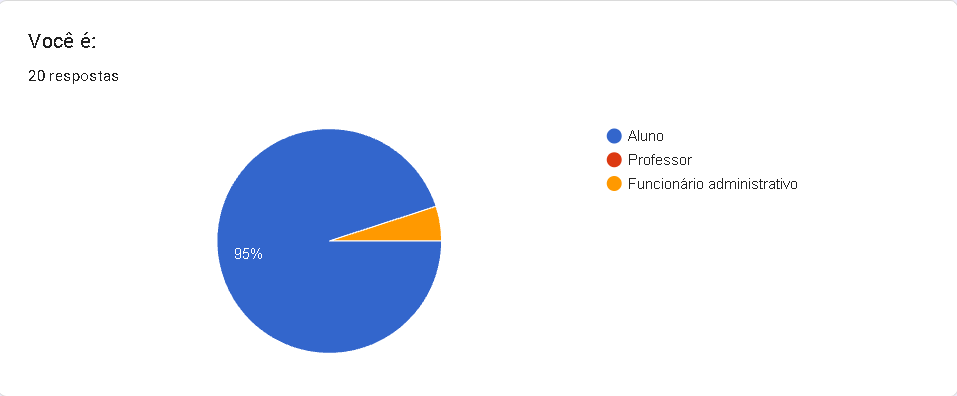
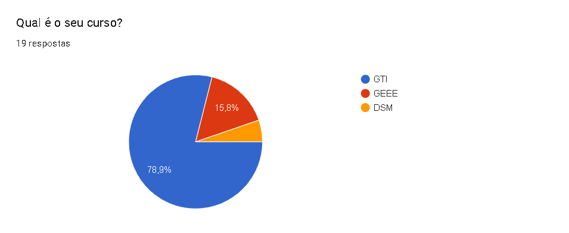
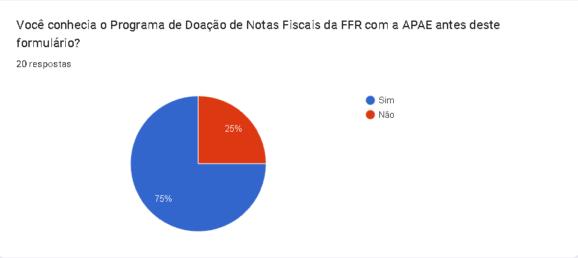
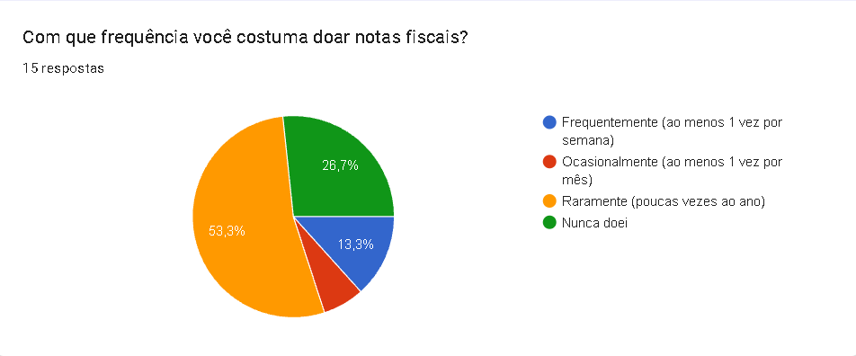
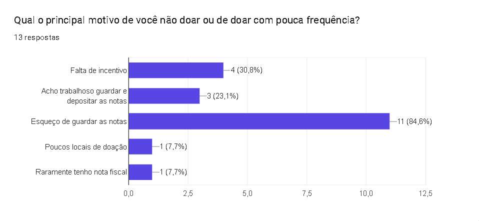
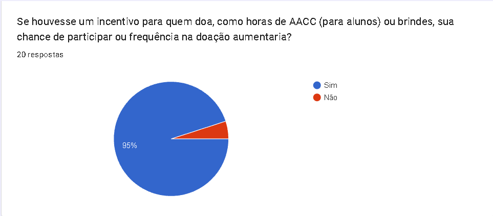
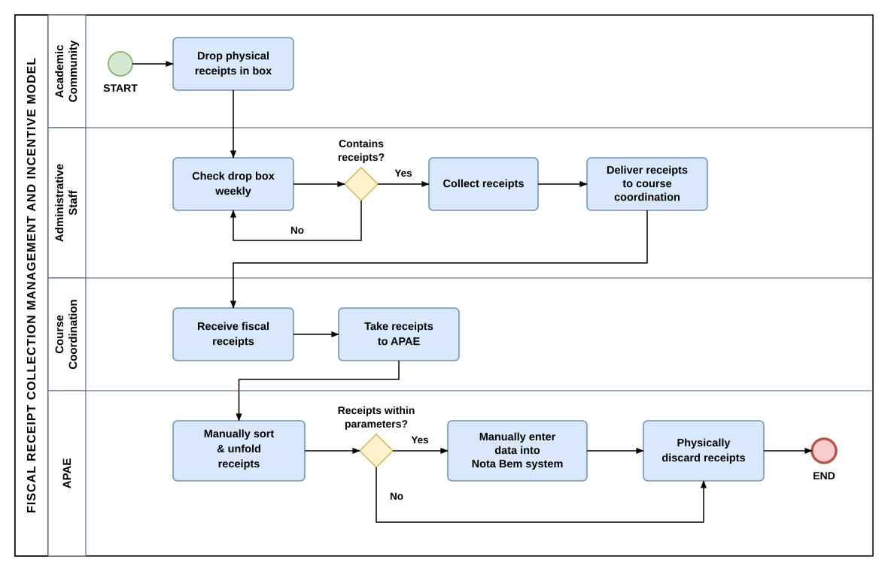
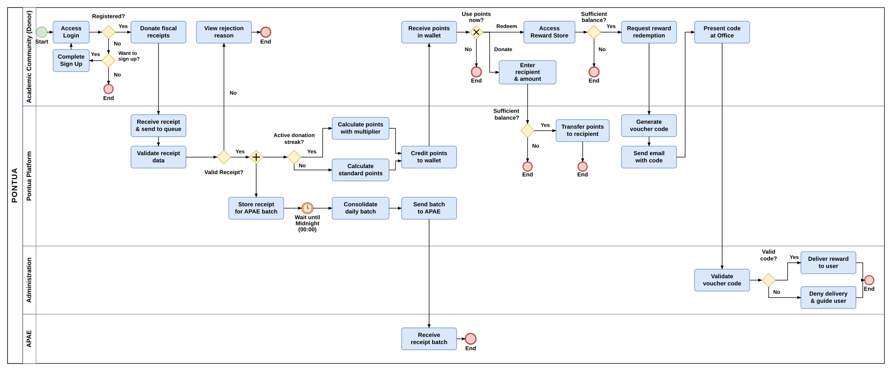

<div align="center">

  <picture>
    <source media="(prefers-color-scheme: dark)" srcset="docs/brand/pontua-logo-dark.svg" />
    <source media="(prefers-color-scheme: light)" srcset="docs/brand/pontua-logo-light.svg" />
    
  </picture>

  <br>

  <p>
    
    
    
    
    
    
    
    
    
    
    
    
    
    
  </p>

  <p>
    <a href="README.md">Português</a> &nbsp;|&nbsp;
    <strong>English</strong>
  </p>

</div>

---

> **Fatec Franco da Rocha** — Information Technology Management  
> Published at **VI SIMBAJU** — Juquery Basin Symposium (Energy & Technology)

---

<br>

# 01 · About the Project

**Pontua** is a web application designed to modernize and boost fiscal receipt donations from the academic community of **Fatec Franco da Rocha (FFR)** to **APAE** (*Association of Parents and Friends of Exceptional People*).

In the legacy workflow, donated fiscal receipts had to be registered in the *Nota Fiscal Paulista* program within a strict **40-day legal window**. Reliance on a physical campus drop box, weekly in-person transportation, and manual paper sorting created operational bottlenecks, expired donations, and low student engagement.

<br>

| Traditional Model (Physical Drop Box) | Pontua Solution (Digital Flow) |
| :--- | :--- |
| Collection restricted to a physical campus box. | **Instant Scanning:** Mobile camera QR Code scanner or 44-digit manual entry. |
| Weekly transport and manual typing at APAE. | **SEFAZ-SP Integration:** Automated receipt data extraction and duplicate blocking. |
| Frequent financial losses due to the 40-day window. | **Automated Daily Batching:** Structured CSV compiled and emailed to APAE at midnight. |
| Low student participation due to lack of incentives. | **Gamification & AACC:** Cumulative points (FIFO), streaks, store, and official certificates. |

<br>
<br>

# 02 · Field Research & Diagnosis

To validate the pain points of the legacy manual workflow and measure the potential impact of a reward-based platform, a quantitative survey was conducted with the academic community at **Fatec Franco da Rocha (FFR)**, complemented by a qualitative interview with course leadership.

* **Sample Profile:** 20 respondents (**95%** students from IT Management, Electrical Systems, and Multiplatform Software Development; **5%** administrative staff).
* **Engagement Gap:** Although **75%** already knew about the donation campaign, **53.3%** donated rarely and **26.7%** had never donated.
* **Primary Barriers:** Forgetting to keep paper receipts (**84.6%**), lack of incentives (**30.8%**), and the inconvenience of storing and depositing receipts into physical boxes (**23.1%**).
* **Solution Validation:** **95%** stated they would participate more frequently if tangible incentives such as **extracurricular credit hours (AACC)** and campus gifts were offered.

<br>

<table>
  <tr>
    <td width="50%" align="center">
      <br>
      <sub><em>Participant role: 95% Students · 5% Admin Staff</em></sub>
    </td>
    <td width="50%" align="center">
      <br>
      <sub><em>Academic program: 78.9% IT Mgmt · 15.8% GEEE · 5.3% DSM</em></sub>
    </td>
  </tr>
  <tr>
    <td width="50%" align="center">
      <br>
      <sub><em>Prior awareness: 75% Yes · 25% No</em></sub>
    </td>
    <td width="50%" align="center">
      <br>
      <sub><em>Donation frequency: 53.3% Rarely · 26.7% Never · 13.3% Weekly</em></sub>
    </td>
  </tr>
  <tr>
    <td width="50%" align="center">
      <br>
      <sub><em>Barriers: 84.6% Forget paper · 30.8% No incentive · 23.1% Hassle</em></sub>
    </td>
    <td width="50%" align="center">
      <br>
      <sub><em>Would donate more with AACC credits/gifts: 95% Yes · 5% No</em></sub>
    </td>
  </tr>
</table>

<br>

# 03 · Business Process Modeling (BPMN)

The software architecture was designed using **BPMN (Business Process Model and Notation)** to eliminate the logistical bottlenecks of the legacy manual workflow.

### 1. Initial Scenario (Legacy Manual Flow)

<p align="center">
  
</p>

* **Identified bottlenecks:** Mandatory weekly faculty transportation, manual paper unfolding and sorting at APAE, manual data entry into *Nota Bem*, and revenue losses due to the 40-day legal expiration window.

<br>

### 2. Proposed Scenario (Fully Automated Flow with Pontua)

<p align="center">
  
</p>

* **Academic Community (Donor):** Scans QR codes, tracks validation status, accumulates points, transfers balances to peers, or redeems rewards and AACC academic hours.
* **Pontua Platform:** Processes receipts asynchronously against SEFAZ and splits into two parallel branches: (1) credits points with streak multipliers to user wallets; (2) consolidates daily CSV batches at midnight (`00:00`) and dispatches them to APAE.
* **FFR Administration:** Validates generated voucher codes for prize pickups or official AACC credit approval.
* **APAE:** Receives formatted digital batches directly via email without handling physical paper.

<br>

# 04 · Key Features

### User Module (Academic Community)

* **Integrated QR Code Scanner:** Real-time mobile camera reading (`jsQR` / `qr-scanner`) or manual access-key entry.
* **Wallet & Point Statement:** Transactional tracking of credits and debits governed by strict **FIFO** expiration rules.
* **Gamification & Streaks:** Daily donation streak multipliers and dynamic academic leaderboard rankings.
* **Peer-to-Peer Point Transfers:** Direct point balance transfers between registered students and staff.
* **Reward Store & AACC Certificates:** Redemption of physical items and issuance of authenticated academic credit certificates ready for printing.

<br>

### Administrative & Governance Module

* **Operational Dashboard:** Real-time metrics tracking total funds raised, processed receipts, APAE dispatches, and community engagement.
* **Automated APAE Dispatch:** Scheduled midnight job (`SendApaeDailyBatchJob`) that compiles and emails daily validated receipt batches.
* **Rewards & Inventory Control:** Product stock management and redemption voucher validation.
* **Moderation & LGPD Compliance:** Audited warnings, account suspension with justification, sensitive data masking, and CSV report exports.

<br>

# 05 · Tech Stack

| Layer | Technology | Purpose |
| :--- | :--- | :--- |
| **Front-end Languages** | **HTML5, CSS3, JavaScript & TypeScript** | Semantic structure, styling, client interactivity, and static typing |
| **Front-end** | **React 19 + Inertia.js + Vite** | Component-driven reactive SPA integrated with Laravel and bundled via Node.js |
| **Styling** | **Tailwind CSS v4** | Utility-first responsive design system |
| **Back-end** | **PHP 8.3+ / Laravel 13** | Business logic, async queues (`Jobs`), task scheduling (`Schedule`), and security |
| **Authentication** | **Laravel Sanctum** | Secure cookie-based SPA authentication with CSRF protection |
| **Database** | **PostgreSQL (Supabase) / SQLite** | Strict relational modeling with referential integrity |
| **Messaging** | **Brevo (SMTP)** | Transactional emails for password resets, reward vouchers, and APAE batches |
| **Infrastructure** | **Oracle Cloud (OCI) + Cloudflare** | Application hosting, reverse proxy, SSL/TLS encryption, CDN, and WAF protection |

<br>

# 06 · Local Setup & Execution

### Prerequisites
* PHP 8.3+ (`pdo`, `mbstring`, `openssl`, `curl` extensions)
* Composer
* Node.js 20+ and npm

<br>

### Step by Step

```bash
# 1. Clone the repository and enter the directory
git clone https://github.com/TheRodrig0/pontua.git
cd pontua

# 2. Install back-end and front-end dependencies
composer install
npm install

# 3. Configure environment variables and generate app key
cp .env.example .env
php artisan key:generate

# 4. Create local database and run migrations with seeders
touch database/database.sqlite
php artisan migrate --seed
```

<br>

Start the development servers:

```bash
# Terminal 1: Laravel web server
php artisan serve

# Terminal 2: Vite asset bundler
npm run dev

# Terminal 3 (Optional): Background queue worker
php artisan queue:work
```

Access locally at: `http://localhost:8000`

<br>

# 07 · Team & Institutions

### Authors
* **Marcos Vinicius de Oliveira Campos**
* **Murilo Decanini dos Santos**
* **Nicolas Santiago Baroco**
* **Rafael Costa Perondi**
* **Rodrigo Jeronimo de Queiroz Silva** ([@TheRodrig0](https://github.com/TheRodrig0))

<br>

### Partner Institutions
* **Fatec Franco da Rocha (FFR):** Public higher education institution — research, development, and validation environment.
* **APAE:** Non-profit organization receiving automated digital fiscal receipt batches.

<br>

# 08 · License

Distributed under the terms available in the [LICENSE](LICENSE) file.

