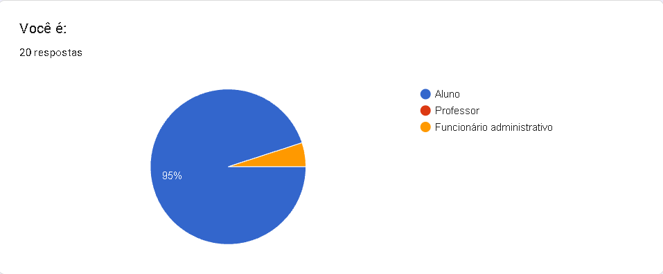
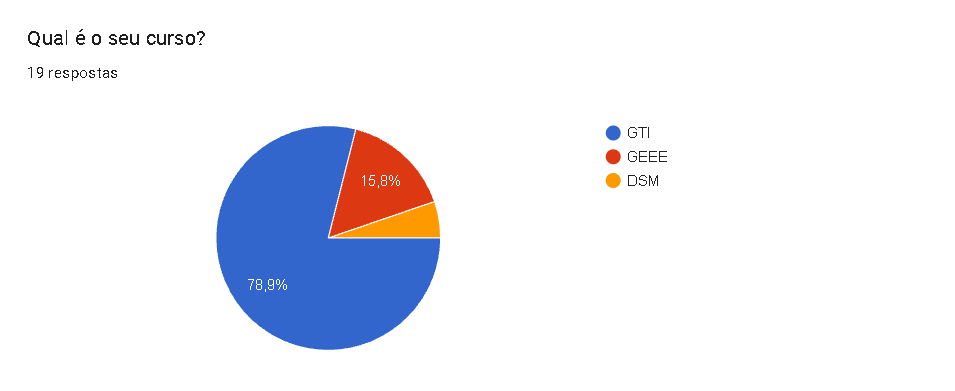
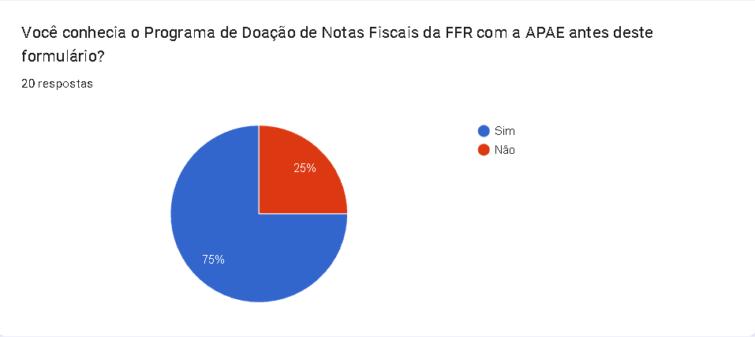
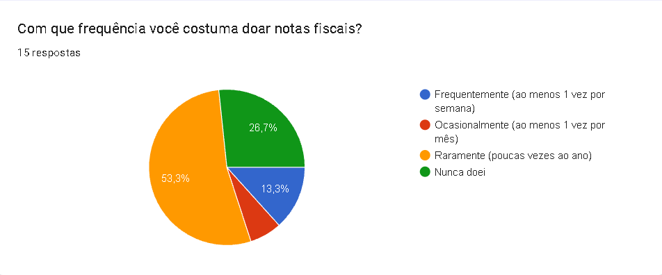
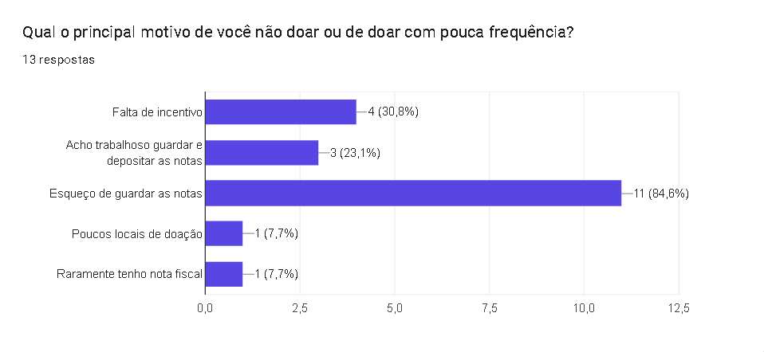
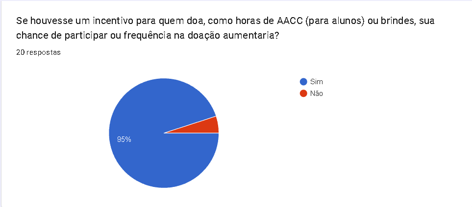
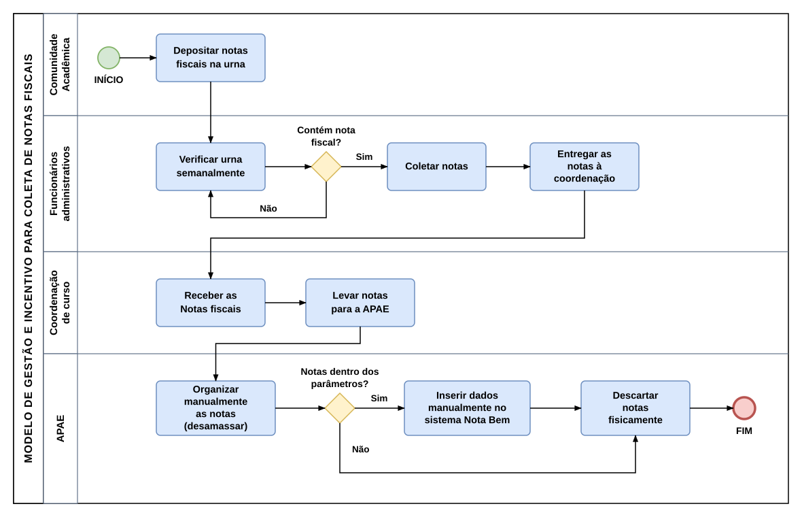
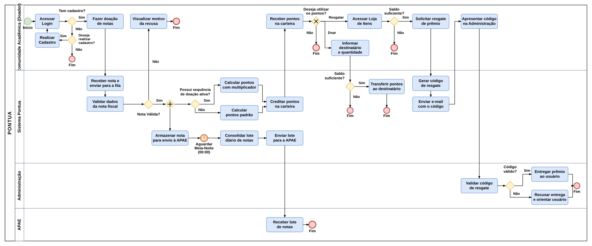

<div align="center">

  <picture>
    <source media="(prefers-color-scheme: dark)" srcset="docs/brand/pontua-logo-dark.svg" />
    <source media="(prefers-color-scheme: light)" srcset="docs/brand/pontua-logo-light.svg" />
    
  </picture>

  <br>
  
  <p>
    
    
    
    
    
    
    
    
    
    
    
    
    
    
  </p>

  <p>
    <strong>Português</strong> &nbsp;|&nbsp;
    <a href="README.en.md">English</a>
  </p>

</div>

---

> **Fatec Franco da Rocha** — Tecnologia em Gestão da Tecnologia da Informação  
> Artigo publicado no **VI SIMBAJU** — Simpósio da Bacia do Juquery (Energia e Tecnologia)

---

<br>

# 01 · Sobre o Projeto

O **Pontua** é uma aplicação web desenvolvida para modernizar e impulsionar a campanha de arrecadação de cupons fiscais da **Fatec Franco da Rocha (FFR)** em benefício da **APAE** (*Associação de Pais e Amigos dos Excepcionais*).

Na operação tradicional, as notas fiscais recebidas pela entidade precisam ser registradas no programa *Nota Fiscal Paulista* dentro de um **prazo legal máximo de 40 dias**. A dependência de uma urna física, o transporte presencial semanal e a triagem manual de papéis geravam gargalos operacionais, perda de notas vencidas e baixa participação estudantil.

<br>

| Modelo Tradicional (Urna Física) | Solução Pontua (Fluxo Digital) |
| :--- | :--- |
| Coleta restrita a uma urna física no campus. | **Leitura Instantânea:** QR Code via câmera ou digitação da chave de 44 dígitos. |
| Transporte semanal e triagem manual exaustiva na APAE. | **Validação SEFAZ-SP:** Extração automática de dados fiscais e bloqueio de duplicatas. |
| Perda constante de notas pelo prazo legal de 40 dias. | **Lote Diário Automatizado:** Envio de CSV estruturado diretamente para a APAE à meia-noite. |
| Baixa adesão dos alunos por falta de retorno palpável. | **Gamificação e AACC:** Pontos acumulativos (FIFO), *streaks*, loja e certificados oficiais. |

<br>
<br>

# 02 · Pesquisa em Campo

Para validar as dores do modelo manual e o impacto potencial do sistema de recompensas, foi aplicado um levantamento quantitativo (*survey*) com a comunidade acadêmica da **Fatec Franco da Rocha (FFR)**, complementado por entrevista qualitativa com a coordenação do curso.

* **Perfil da Amostra:** 20 respondentes (**95%** alunos dos cursos de GTI, GEEE e DSM; **5%** funcionários administrativos).
* **Gargalo de Adesão:** Embora **75%** já conhecessem o programa de doação, **53,3%** doavam raramente e **26,7%** nunca haviam doado.
* **Principais Motivos:** Esquecimento de guardar as notas em papel (**84,6%**), falta de incentivo (**30,8%**) e trabalho para guardar e depositar na urna física (**23,1%**).
* **Validação da Solução:** **95%** afirmaram que participariam com maior frequência caso houvesse incentivos como **horas complementares (AACC)** e brindes.

<br>

<table>
  <tr>
    <td width="50%" align="center">
      
    </td>
    <td width="50%" align="center">
      
    </td>
  </tr>
  <tr>
    <td width="50%" align="center">
      
    </td>
    <td width="50%" align="center">
      
    </td>
  </tr>
  <tr>
    <td width="50%" align="center">
      
    </td>
    <td width="50%" align="center">
      
    </td>
  </tr>
</table>

<br>

# 03 · Processos de Negócio (BPMN)

A arquitetura de software foi orientada pela modelagem de processos (**BPMN**) para eliminar os gargalos operacionais do modelo manual.


### 1. Cenário Inicial (Fluxo Manual com Urna Física)

<p align="center">
  
</p>

* **Gargalos mapeados:** Deslocamento semanal obrigatório da coordenação, desamasso manual de cupons na APAE, digitação no sistema *Nota Bem* e perdas financeiras por expiração do prazo legal de 40 dias.

<br>

### 2. Cenário Proposto (Automação Completa com o Pontua)

<p align="center">
  
</p>

* **Comunidade Acadêmica (Doador):** Escaneia o QR Code, acompanha a validação, acumula pontos, transfere saldo ou resgata prêmios/horas AACC.
* **Sistema Pontua:** Processa assincronamente na SEFAZ e bifurca o fluxo: (1) credita pontos com multiplicador de sequência na carteira; (2) consolida o lote diário em CSV à meia-noite (`00:00`) e despacha para a APAE.
* **Administração FFR:** Valida o voucher para entrega de brindes ou homologação de certificados AACC.
* **APAE:** Recebe os lotes fiscais digitais formatados por e-mail, sem contato com papel.

<br>

# 04 · Funcionalidades

### Módulo do Usuário (Comunidade Acadêmica)

* **Leitor de QR Code Integrado:** Leitura em tempo real via câmera (`jsQR` / `qr-scanner`) ou entrada manual.
* **Carteira e Extrato de Pontos:** Controle transacional de créditos e débitos com regra de expiração **FIFO**.
* **Gamificação e Streaks:** Bônus multiplicadores por dias consecutivos de doação e ranking acadêmico dinâmico.
* **Transferência entre Alunos:** Repasse direto de saldo de pontos entre usuários cadastrados.
* **Loja e Certificados AACC:** Resgate de itens físicos e emissão de certificados de horas complementares com autenticação.

<br>

### Módulo Administrativo e Governança

* **Painel de Controle:** Métricas operacionais em tempo real de notas, arrecadação repassada e engajamento.
* **Despacho Automático para a APAE:** Rotina diária (`SendApaeDailyBatchJob`) que consolida e envia o lote de cupons por e-mail.
* **Gestão de Recompensas e Estoque:** Controle de inventário de produtos e validação de códigos de resgate.
* **Moderação e Conformidade LGPD:** Registro de advertências, bloqueio auditado de contas e mascaramento de dados sensíveis.

<br>

# 05 · Stack Tecnológica

| Camada | Tecnologia | Finalidade |
| :--- | :--- | :--- |
| **Linguagens Front-end** | **HTML5, CSS3, JavaScript & TypeScript** | Estrutura semântica, estilização, interatividade e tipagem estática |
| **Front-end** | **React 19 + Inertia.js + Vite** | Interface SPA reativa orientada a componentes e empacotamento via Node.js |
| **Estilização** | **Tailwind CSS v4** | Sistema visual utilitário e responsivo |
| **Back-end** | **PHP 8.3+ / Laravel 13** | Regras de negócio, filas assíncronas (`Jobs`), agendamento (`Schedule`) e segurança |
| **Autenticação** | **Laravel Sanctum** | Autenticação SPA segura via cookies com proteção CSRF |
| **Banco de Dados** | **PostgreSQL (Supabase) / SQLite** | Modelagem relacional estrita com integridade referencial |
| **Mensageria** | **Brevo (SMTP)** | E-mails transacionais de recuperação de senha, vouchers e lotes da APAE |
| **Infraestrutura** | **Oracle Cloud (OCI) + Cloudflare** | Hospedagem de aplicação, proxy reverso, SSL/TLS, CDN e proteção WAF |

<br>

# 06 · Instalação e Execução Local

### Pré-requisitos
* PHP 8.3+ (extensões `pdo`, `mbstring`, `openssl`, `curl`)
* Composer
* Node.js 20+ e npm

<br>

### Passo a Passo

```bash
# 1. Clonar repositório e acessar diretório
git clone https://github.com/TheRodrig0/pontua.git
cd pontua

# 2. Instalar dependências
composer install
npm install

# 3. Configurar ambiente e chave
cp .env.example .env
php artisan key:generate

# 4. Criar banco local e executar migrações com seeders
touch database/database.sqlite
php artisan migrate --seed
```

<br>

Inicie os serviços de desenvolvimento:

```bash
# Terminal 1: Servidor web
php artisan serve

# Terminal 2: Compilação de assets (Vite)
npm run dev

# Terminal 3 (Opcional): Worker de filas em segundo plano
php artisan queue:work
```

Acesse em: `http://localhost:8000`

<br>

# 07 · Equipe e Instituições

### Autores
* **Marcos Vinicius de Oliveira Campos**
* **Murilo Decanini dos Santos**
* **Nicolas Santiago Baroco**
* **Rafael Costa Perondi**
* **Rodrigo Jeronimo de Queiroz Silva** ([@TheRodrig0](https://github.com/TheRodrig0))

<br>

### Instituições Envolvidas
* **Fatec Franco da Rocha (FFR):** Instituição de ensino superior — ambiente de pesquisa, desenvolvimento e validação.
* **APAE:** Organização da sociedade civil beneficiada pelos lotes automatizados de cupons fiscais.

<br>

# 08 · Licença

Distribuído sob os termos da licença disponível no arquivo [LICENSE](LICENSE).
